# PatchGoblin for Questi

**Doing the job their UI designer was paid for.**

PatchGoblin is the lightweight addon that strips away the user-hostile layout, bypasses the clumsy
navigation, and restores sanity to your workflow. Because life is too short for a terrible UI.

> PatchGoblin is an independent, unofficial project. It is not made, endorsed or supported by Questi.

---

## Wat het doet

PatchGoblin legt één venster over je Questi-agenda, bereikbaar met één knop in de werkbalk
(of **Alt + P**). Daarin:

- **Plannen** — deze week en volgende week onder elkaar. Sleep lesfiches uit de lijst links op je
  lesuren; de lijst toont wat je al gaf en wat nog niet.
- **Doelen** — schakel naar één week en zie per les **WEET / KEN / KAN**. De doelen staan in de
  lesfiche zelf, dus ook op je andere computer en bij je collega's.
- **Lesfiches** — je hele bibliotheek: titels, tags, leerjaren en doelen in één tabel, met een
  volledige editor per fiche.
- **Afdrukken** — je week op papier, met schrijflijnen voor de lesdoelen, in de kleuren van je vakken.
- **Eén keer controleren** — niets gaat naar Questi voor je alle wijzigingen samen nakijkt en
  goedkeurt. Een lesuur dat deel is van een reeks wordt nooit als hele reeks aangepast.
- **Weken vooruit plannen** — blader verder en je wijzigingen blijven klaarstaan; plan een hele
  maand en schrijf alles in één keer weg. Vakantieweken worden overgeslagen.
- **Nieuwe lesfiches maken** — sjabloon, velden, tags, WEET/KEN/KAN en de Op.Stap-leerplandoelen
  (met de echte Op.Stap-kiezer), zonder Questi's editor.

| Onderdeel | Status |
|---|---|
| Plannen · Lesfiches · Afdrukken in één venster, Methodevoortgang | werkt (v1.4) |
| Eén PatchGoblin-knop met snelmenu | werkt |
| Eén Controleer voor tags, lesfiches en agenda | werkt |
| Weken vooruit plannen, vakantieweken overslaan | werkt |
| Eerste installatie (wizard), instellingen delen (.json) | werkt |
| Nieuwe lesfiche met Op.Stap-leerplandoelen | werkt (methode-sjablonen: doelen nog in Questi) |
| Tags hernoemen en herkleuren (✎ in de tagboom) | werkt (v1.5) |

## Voor wie

Leerkrachten die hun lessen in Questi plannen. Werkt met je **eigen** Questi-account en je
**eigen** tags: bij de eerste start duid je aan welke tags je vakken zijn en welk vak je op welk
lesuur geeft. Een collega van je school kan jouw instellingen als bestand overnemen.

## Hulp nodig?

Open **Debug** (onderaan links) en klik **Opslaan als .json**. Stuur dat bestand mee met je vraag.
Het bevat geen wachtwoord, cookies of sessie — wel je schoolnaam, tags, titels van lesfiches
(kan je weglaten) en de laatste foutmeldingen.

---

# Handleiding

> De schermafbeeldingen hieronder tonen PatchGoblin met **verzonnen voorbeeldgegevens** (een
> fictieve juf en school). Bij jou staan er je eigen vakken, lesuren en lesfiches.

PatchGoblin legt één venster over je Questi-agenda. Je plant er twee weken tegelijk, beheert je
lesfiches, vult lesdoelen in en drukt je week af. **Niets gaat naar Questi** voor jij alle
wijzigingen samen nakijkt en op **Wegschrijven** klikt. Werkt in **Chrome**, **Brave** en **Edge**,
met je gewone Questi-login.

## 1. Installeren

De makkelijkste weg is de stap-voor-stap-gids: **[PatchGoblin installeren](https://claude.ai/artifact/BzuDN1SfiziugCxB5YvToL)**.
In het kort:

1. Download [`install.bat`](https://github.com/RareGoudvis/PatchGoblin/blob/main/install.bat)
   en dubbelklik het. Het zet PatchGoblin in `%LOCALAPPDATA%\PatchGoblin`, kopieert die map naar je
   klembord en opent de extensiepagina van je browser.
2. Zet daar **Ontwikkelaarsmodus** aan (Chrome/Brave: rechtsboven, Edge: links).
3. Klik **Uitgepakt laden**, plak de map (Ctrl+V, Enter) en klik **Map selecteren**.
4. Herlaad je Questi-agenda (F5).

Op een pc die door de school beheerd wordt, staat ontwikkelaarsmodus soms uit. Gebruik dan je
eigen computer. Op een Mac: download de ZIP (groene knop **Code → Download ZIP**), pak hem uit en
kies die map bij stap 3.

**Bijwerken.** Meldt PatchGoblin een nieuwe versie, dubbelklik dan `update.bat` in
`%LOCALAPPDATA%\PatchGoblin`. Het kijkt de download eerst na, maakt een back-up van je huidige
versie (in `%LOCALAPPDATA%\PatchGoblin-backups`) en zet die vanzelf terug als het vervangen
mislukt. Klik daarna op de extensiepagina op **↻** bij PatchGoblin en herlaad Questi.

## 2. Openen

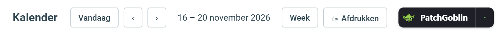

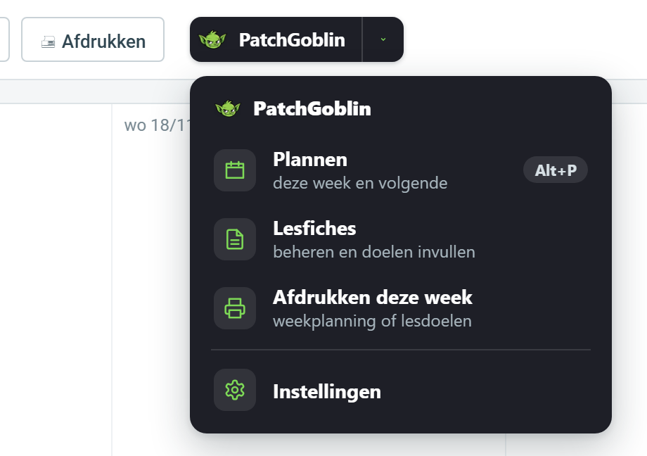

Op je Questi-**agenda** staat de knop **PatchGoblin** in de werkbalk. Klik hem, of druk
**Alt + P**. Het pijltje ernaast opent een snelmenu: **Plannen**, **Lesfiches**, **Afdrukken deze
week** en **Instellingen**. Staan er nog wijzigingen klaar, dan zie je daar ook hoeveel.

**De eerste keer** opent een korte wizard:

1. **Vakken**: duid aan welke van je Questi-tags echte vakken zijn (wiskunde, taal …).
2. **Lesrooster**: kies per lesuur het vak. PatchGoblin stelt voor wat het al in je agenda ziet
   (met een oranje rand); bevestig of pas aan.
3. **Agenda**: zet "Vak als beschrijving" alleen aan als je klaswebsite (bv. Enderklas) de
   beschrijving van een les als vak toont.

Alles kan later nog in **Instellingen**.

## 3. Plannen

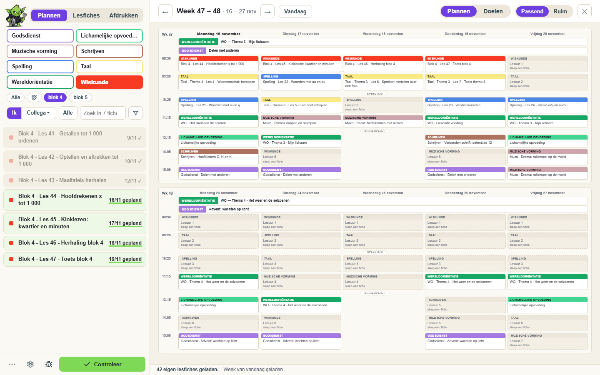

Het venster heeft links een zijbalk met drie tabbladen: **Plannen · Lesfiches · Afdrukken**.

- **Rechts** staan **deze week en volgende week** onder elkaar. Elke kaart is een lesuur: bovenaan
  het vak in de kleur van je Questi-tag, daaronder de les. Een gestippelde kaart heeft nog geen
  lesfiche. Met **← →** blader je een week verder; **Vandaag** brengt je terug. Vakantieweken
  worden overgeslagen.
- **Links** staat je lijst met lesfiches. Kies bovenaan een **vak**, verfijn met de subtags
  (blok 4, blok 5 …), of kies **Ik / Collega** om de fiches van een collega of een methode te zien.
  **Filter** klapt zoeken, leerjaar en sorteren open.
- Achter elke fiche staat wanneer je ze gebruikte: groen **gepland** (staat in deze weken),
  een grijs ✓ (dit schooljaar al gegeven), of de laatste datum / **nooit**.

**Een les plannen**

- **Sleep** een fiche uit de lijst op een lesuur. Het lesuur krijgt de titel en het vak van de fiche.
- **Klik** op een lesuur om een fiche te kiezen, de titel aan te passen, het vak te wijzigen, het
  leeg te maken, of het te markeren als **Lichamelijke opvoeding / zwemmen** (geen fiche, enkel
  een titel).
- Sleep een ingevulde kaart naar een ander lesuur om te **verplaatsen of te wisselen**.
- **Ctrl + Z** draait je laatste actie terug.

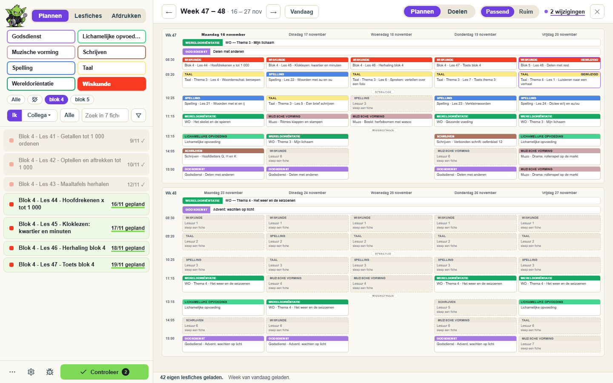

Wat je verandert, wordt eerst **klaargezet**: de kaart krijgt een groene rand en bovenaan staat
hoeveel wijzigingen er wachten. Je kan gerust verder bladeren en een hele maand vooruit plannen —
klaargezette wijzigingen blijven staan tot je ze wegschrijft of de pagina herlaadt.

**Het menu Alles** (onderaan de zijbalk) bevat de rest:

| Groep | Wat |
|---|---|
| Deze weken | **Kopieer vorige week** · **Titels opschonen** (haalt Questi's `* … (1)` uit titels) · **Vakken herstellen** · **Ongedaan maken** · **Vernieuwen** · **Balans** (lesuren per vak) |
| Lesfiches | **Zoek in alle lesfiches** (jij, collega's en methodes tegelijk) · **Eigen lesfiches herladen** · **Lesfiches van collega's** · **Methodes** |
| Overzicht | **Methodevoortgang** |

**Themarijen.** Hele-week-items zoals WO of Godsdienst staan als brede balk bovenaan elke week.
Leg er de themafiche van die week in. Herkent PatchGoblin het thema niet, klik dan de balk en kies
het vak: dat wordt onthouden.

## 4. Controleren en wegschrijven

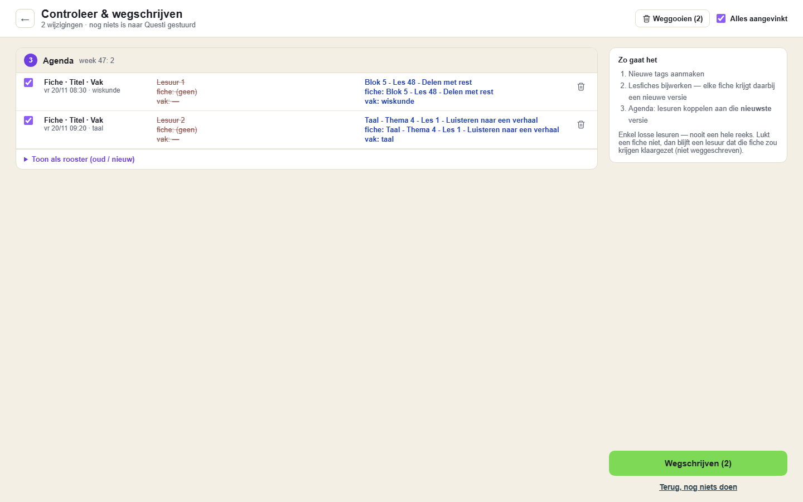

Klik **Controleer** (onderaan de zijbalk). Je ziet alles wat klaarstaat, in de volgorde waarin het
naar Questi gaat: eerst nieuwe tags, dan aangepaste lesfiches, dan de lesuren in je agenda.

- Elke rij heeft een **vinkje**. Wat je uitvinkt, blijft klaargezet voor later.
- Met het **vuilbakje** gooi je een wijziging weg: het lesuur gaat terug naar wat er in Questi staat.
- **Toon als rooster** toont de weken voor en na naast elkaar.
- Bij aangepaste lesfiches wordt eerst een **back-up** (JSON-bestand) gedownload.

Klik **Wegschrijven**. Een lesuur uit een herhalende reeks wordt altijd **alleen voor die ene
week** aangepast, nooit de hele reeks. Daarna herlaadt Questi en opent PatchGoblin vanzelf weer op
dezelfde weken.

**Als iets misgaat** zegt het venster per onderdeel wat lukte en wat niet. Wat niet lukte, blijft
klaargezet. Antwoordt Questi niet (bv. een trage verbinding), dan kijkt PatchGoblin zelf na of het
toch aankwam. Lukt ook dat niet, dan staat het er als **onzeker** bij: kijk het even na in Questi
voor je opnieuw wegschrijft.

## 5. Doelen

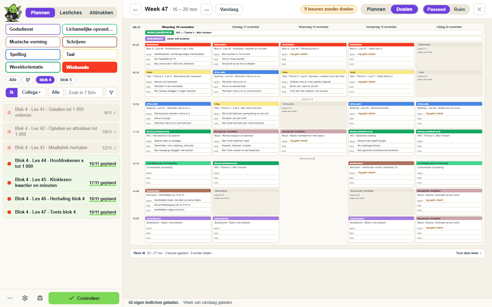

Schakel bovenaan van **Plannen** naar **Doelen**. Je ziet één week, en op elke kaart de
**WEET / KEN / KAN**-doelen van de lesfiche. Bovenaan staat hoeveel lessen nog geen doelen hebben.
Klik de balk van de andere week om te wisselen.

De doelen staan **in de lesfiche zelf** (drie extra tekstvelden WEET, KEN en KAN). Ze zijn dus ook
zichtbaar in Questi, op je andere computer en voor collega's met wie je de fiche deelt. Invullen
doe je in **Lesfiches** (zie hieronder).

## 6. Lesfiches

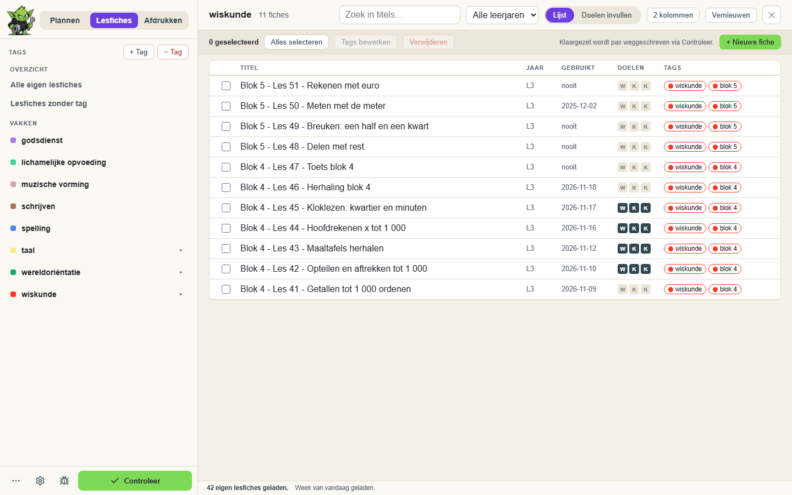

Het tabblad **Lesfiches** toont je hele bibliotheek.

- **Links** je tags als boom: **Alle eigen lesfiches**, **Zonder tag** en je vakken met hun
  subtags. Met **✎** naast een eigen tag hernoem of herkleur je hem, of hang je hem onder een
  ander vak. **+ Tag** maakt een nieuwe.
- **Rechts** een tabel met titel, leerjaar, laatst gebruikt en tags. Klik een kolomkop om te
  sorteren, filter op leerjaar of zoek op titel.
- **Een titel aanpassen**: klik erop en typ.
- **Meerdere tegelijk**: vink fiches aan en kies **Tags bewerken** of **Verwijderen**. Verwijderen
  is definitief: je typt eerst `VERWIJDER` en er wordt automatisch een back-up gedownload.
- **Lesdoelen invullen** zet de lijst om in een invulblad: per fiche Titel · WEET · KEN · KAN.
  **Tab** = volgend vak, **Enter** = zelfde kolom, volgende fiche.

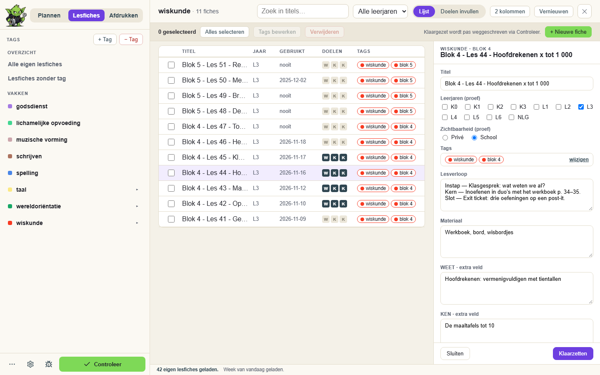

**Dubbelklik** een fiche voor de volledige editor: titel, leerjaren, zichtbaarheid, tags, alle
tekstvelden (ook WEET/KEN/KAN) en **+ Tekstveld toevoegen**. Sjabloon, bijlagen en
leerplandoelen staan er ter info bij.

**+ Nieuwe fiche** maakt een fiche zonder Questi's editor: kies een sjabloon, vul titel, leerjaren,
tags, tekstvelden en WEET/KEN/KAN in, en kies de **leerplandoelen** met de echte Op.Stap-kiezer.

Ook hier wordt alles eerst **klaargezet** en pas weggeschreven via dezelfde **Controleer** als bij
Plannen. Fiches die je aanpast en die al in je agenda staan, kan je daar meteen laten meeverhuizen
naar de nieuwe versie.

## 7. Afdrukken

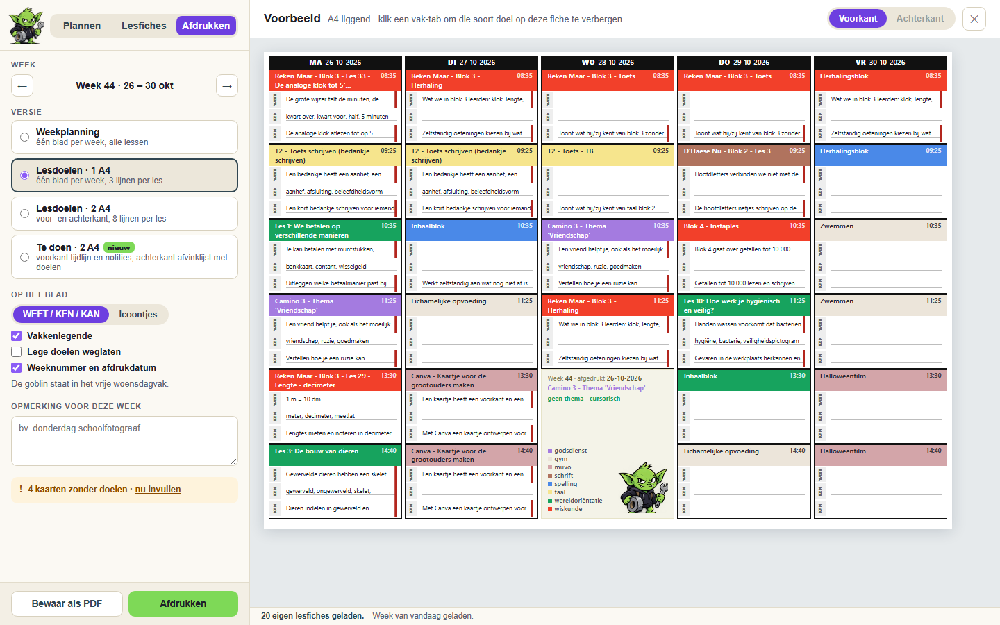

Het tabblad **Afdrukken** toont een voorbeeld op A4 van de week die in Questi staat (dus niet je
klaargezette wijzigingen — die zegt het er ook bij).

- **Versie**: **Gewoon** (je weekplanning) of **Lesdoelen** op 1 of 2 A4, met per les
  schrijflijnen voor WEET, KEN en KAN. Op de vrije woensdagnamiddag staan de thema's en de legende
  met je vakkleuren.
- **Op het blad**: weeknummer en afdrukdatum, labels, legende.
- **Andere agenda's meeprinten**, bv. die van de zorgjuf. Klik een item om het te verbergen.
- **Opmerking voor deze week** komt mee op het blad.
- "**N kaarten zonder doelen · nu invullen**" brengt je meteen naar die fiches.
- **Bewaar als PDF** of **Afdrukken** opent het afdrukvenster van je browser.

## 8. Instellingen

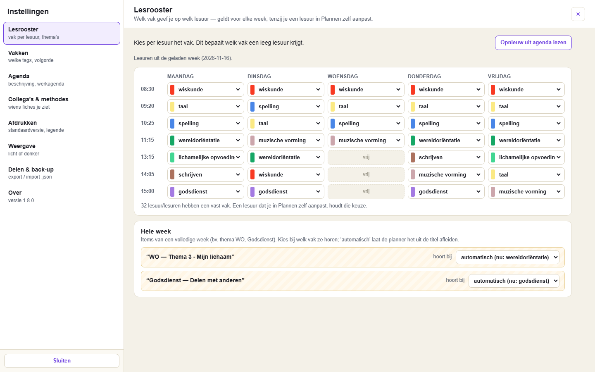

**Instellingen** (onderaan de zijbalk, of via het snelmenu):

- **Lesrooster**: welk vak je op welk lesuur geeft. PatchGoblin vult lege uren ook zelf aan met
  wat het in je agenda ziet; wat je met de hand zet, blijft.
- **Vakken**: welke tags vakken zijn, hun volgorde en afkortingen.
- **Agenda**: o.a. "Vak als beschrijving schrijven".
- **Collega's & methodes**: wiens fiches je in de lijst kan kiezen.
- **Afdrukken**: standaardversie en wat er op het blad komt.
- **Weergave**: licht, donker of volgens je computer.
- **Delen & back-up**: je instellingen als bestand bewaren of overnemen van een collega.
  Vakken gaan mee op naam en kleur, dus het werkt ook met de tags van iemand anders.

## 9. Methodevoortgang

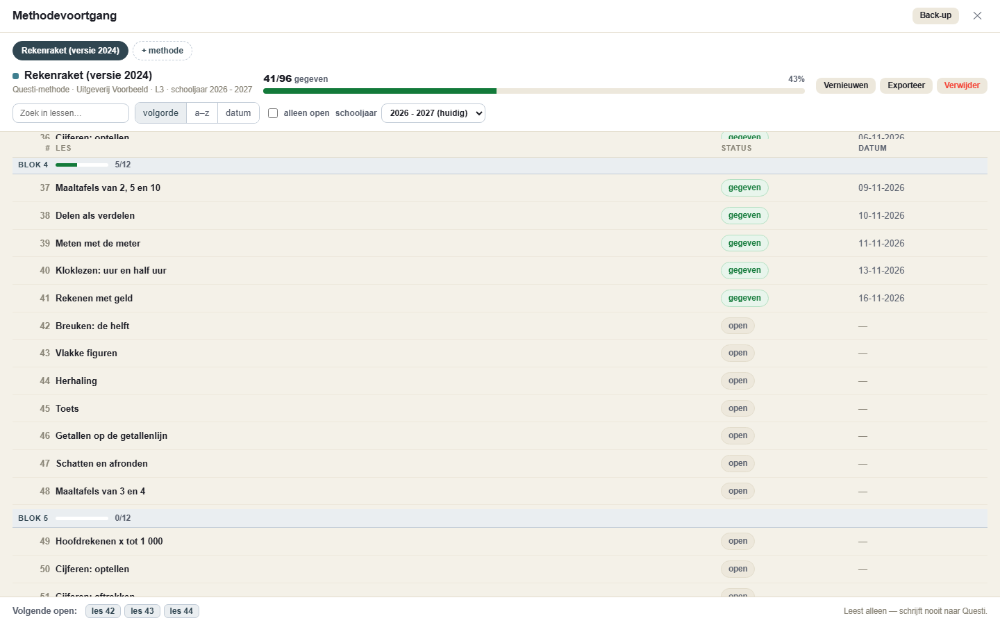

Via **Alles → Methodevoortgang**. Per methode zie je welke lessen je dit schooljaar al gaf en welke
nog open staan, gegroepeerd per thema of blok, met een voortgangsbalk en de **overgeslagen**
lessen. Het **leest alleen**: er wordt nooit iets naar Questi geschreven.

- Een methode komt **uit Questi** (de methodes van je school) of **uit eigen lesfiches** (kies een
  vak en vink één keer aan welke fiches de methode vormen; de subtags worden de thema's).
- "Gegeven" = de lesfiche werd binnen het gekozen **schooljaar** gebruikt. Rechtsboven kies je het
  schooljaar. Klik een statuspil om het met de hand te zetten.
- **Exporteer** geeft een CSV; **Back-up** neemt je methodes mee naar een andere computer.

## 10. Lukt het niet?

- **Geen PatchGoblin-knop?** Herlaad Questi (F5) en kijk of de extensie aan staat op de
  extensiepagina.
- **Na een update doet iets raar?** Klik op de extensiepagina op ↻ bij PatchGoblin **en** herlaad
  je Questi-tabblad. Meldt de statusregel "Instellingen niet bewaard", dan is dat precies dit.
- **Iets klopt niet?** Open **Debug** (onderaan de zijbalk): de **Zelftest** leest alleen en zegt
  wat er mis is. Klik **Opslaan als .json** en stuur dat bestand mee met je vraag. Het bevat geen
  wachtwoord, cookies of sessie — wel je schoolnaam, tags, titels van lesfiches (kan je weglaten)
  en de laatste foutmeldingen.
- **PatchGoblin weer weg?** Klik op de extensiepagina op **Verwijderen**. Je agenda in Questi
  blijft zoals hij is.

---

## Privacy

De extensie draait volledig in je eigen browser en praat enkel met `questi.com` via je eigen
login, plus `raw.githubusercontent.com` om te kijken of er een nieuwe versie is. Er worden geen
gegevens naar derden gestuurd, er is geen eigen server en er wordt niets gevolgd.

---

## For developers

How PatchGoblin is built, and everything known about Questi's unofficial API it relies on, is in
[`Questi_unofficial_api.md`](Questi_unofficial_api.md).
